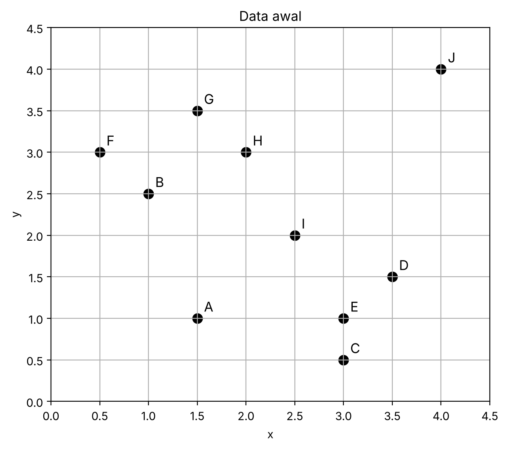
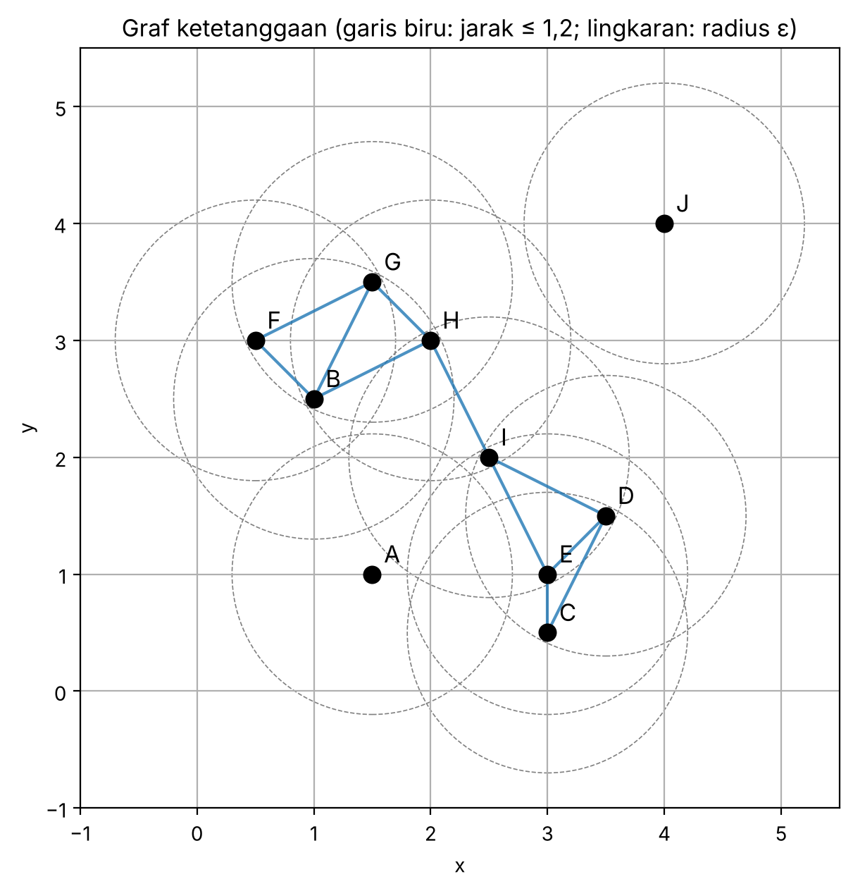
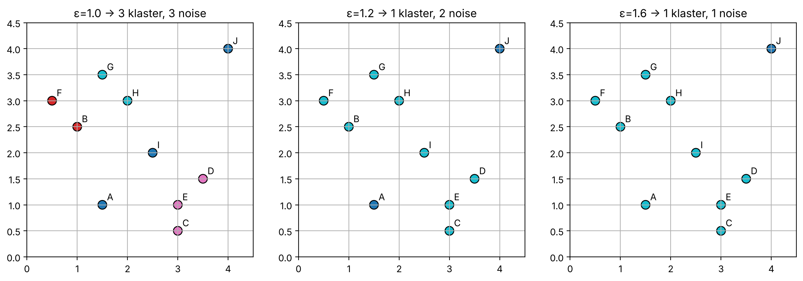
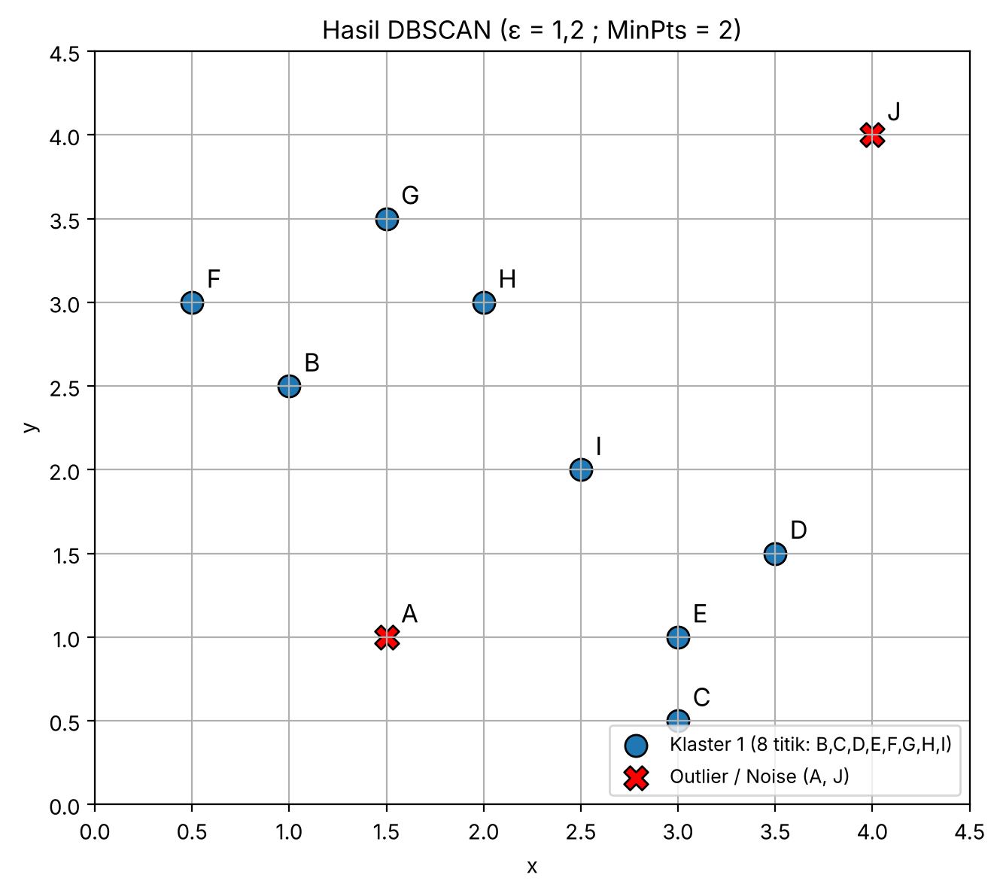

# Jawaban Soal 2 – Unsupervised Learning (Clustering Analysis): DBSCAN
**Mata Kuliah:** Data Mining (CPMK111) | **Bobot:** 25 poin

> **Catatan koordinat:** foto soal agak buram, sehingga koordinat titik dibaca dari grid (kelipatan 0,5). **Cocokkan dulu dengan soal aslimu.** Jika ada titik yang berbeda, ubah di notebook `DBSCAN_Soal2.ipynb` (sel "data") lalu jalankan ulang.

| Titik | A | B | C | D | E | F | G | H | I | J |
|---|---|---|---|---|---|---|---|---|---|---|
| **x** | 1,5 | 1,0 | 3,0 | 3,5 | 3,0 | 0,5 | 1,5 | 2,0 | 2,5 | 4,0 |
| **y** | 1,0 | 2,5 | 0,5 | 1,5 | 1,0 | 3,0 | 3,5 | 3,0 | 2,0 | 4,0 |

---

## 2a. Karakteristik Algoritma DBSCAN

**DBSCAN** (*Density-Based Spatial Clustering of Applications with Noise*, Ester dkk., 1996) adalah algoritma klastering berbasis **kepadatan (density)**. Klaster dipandang sebagai daerah padat yang dipisahkan oleh daerah jarang. Titik di daerah jarang dianggap **noise/outlier**.

### Dua parameter
| Parameter | Arti |
|---|---|
| **ε (epsilon)** | Radius lingkungan sebuah titik. Titik *q* adalah tetangga *p* jika jarak(p, q) ≤ ε |
| **MinPts** | Jumlah minimum titik dalam ε-neighborhood (umumnya termasuk titik itu sendiri) agar suatu titik disebut padat |

### Tiga jenis titik
1. **Core point** – memiliki ≥ MinPts titik dalam radius ε.
2. **Border point** – bukan core, tetapi berada dalam radius ε dari suatu core point.
3. **Noise (outlier)** – bukan core dan bukan border.

### Konsep keterhubungan
- **Directly density-reachable:** q dapat dijangkau langsung dari p jika q ada di ε-neighborhood p dan p adalah core point.
- **Density-reachable:** q dapat dijangkau dari p lewat rantai titik-titik yang saling directly density-reachable.
- **Density-connected:** p dan q density-connected jika ada titik o yang dapat menjangkau keduanya.
- **Klaster** = himpunan maksimal titik yang saling density-connected.

### Langkah algoritma
1. Pilih titik yang belum dikunjungi, hitung ε-neighborhood-nya.
2. Jika jumlah tetangga < MinPts, tandai sementara sebagai noise (bisa berubah jadi border jika nanti dijangkau core point).
3. Jika ≥ MinPts, titik itu core: buat klaster baru, masukkan seluruh tetangganya.
4. Perluas klaster: untuk tiap tetangga yang juga core, tambahkan tetangga-tetangganya, ulangi sampai tidak ada penambahan.
5. Ulangi dari langkah 1 sampai semua titik dikunjungi.

### Kelebihan dan kekurangan
| Kelebihan | Kekurangan |
|---|---|
| Tidak perlu menentukan jumlah klaster di awal | Sensitif terhadap pemilihan ε dan MinPts |
| Dapat membentuk klaster berbentuk sembarang (non-spherical) | Sulit bila kepadatan antarklaster berbeda-beda |
| Mampu mendeteksi noise/outlier secara bawaan | Kurang baik pada data berdimensi tinggi (jarak kehilangan makna) |
| Tahan terhadap outlier | Hasil bisa bergantung pada urutan data untuk border point |

Kompleksitas: O(n²) tanpa indeks spasial, O(n log n) dengan indeks (k-d tree / R*-tree).

---

## 2b. Perhitungan Klasterisasi (ε = 1,2 ; MinPts = 2)

Konvensi: ε-neighborhood **menghitung titik itu sendiri** (konvensi Ester dkk. dan scikit-learn). Maka titik menjadi *core* bila punya **minimal 1 tetangga lain** dalam jarak ≤ 1,2. (Hasil yang sama juga didapat jika diri sendiri tidak dihitung, lihat bagian "Uji kekokohan".)

*Gambar 1. Sebaran data awal (A–J).*

### Langkah 1 – Matriks jarak Euclidean
Rumus: d(p,q) = √[(xₚ − x_q)² + (yₚ − y_q)²]. Contoh: d(B,F) = √[(1,0−0,5)² + (2,5−3,0)²] = √0,5 = **0,707**.

| | A | B | C | D | E | F | G | H | I | J |
|---|---|---|---|---|---|---|---|---|---|---|
| **A** | 0 | 1,581 | 1,581 | 2,062 | 1,500 | 2,236 | 2,500 | 2,062 | 1,414 | 3,905 |
| **B** | 1,581 | 0 | 2,828 | 2,693 | 2,500 | **0,707** | **1,118** | **1,118** | 1,581 | 3,354 |
| **C** | 1,581 | 2,828 | 0 | **1,118** | **0,500** | 3,536 | 3,354 | 2,693 | 1,581 | 3,640 |
| **D** | 2,062 | 2,693 | **1,118** | 0 | **0,707** | 3,354 | 2,828 | 2,121 | **1,118** | 2,550 |
| **E** | 1,500 | 2,500 | **0,500** | **0,707** | 0 | 3,202 | 2,915 | 2,236 | **1,118** | 3,162 |
| **F** | 2,236 | **0,707** | 3,536 | 3,354 | 3,202 | 0 | **1,118** | 1,500 | 2,236 | 3,640 |
| **G** | 2,500 | **1,118** | 3,354 | 2,828 | 2,915 | **1,118** | 0 | **0,707** | 1,803 | 2,550 |
| **H** | 2,062 | **1,118** | 2,693 | 2,121 | 2,236 | 1,500 | **0,707** | 0 | **1,118** | 2,236 |
| **I** | 1,414 | 1,581 | 1,581 | **1,118** | **1,118** | 2,236 | 1,803 | **1,118** | 0 | 2,500 |
| **J** | 3,905 | 3,354 | 3,640 | 2,550 | 3,162 | 3,640 | 2,550 | 2,236 | 2,500 | 0 |

*(Angka tebal = jarak ≤ 1,2, yaitu tetangga.)*

### Langkah 2 – ε-neighborhood dan jenis titik

| Titik | Tetangga (jarak ≤ 1,2) | \|N_ε\| (incl. diri) | ≥ MinPts (2)? | Jenis |
|---|---|---|---|---|
| A | – | 1 | Tidak | Noise |
| B | F, G, H | 4 | Ya | Core |
| C | D, E | 3 | Ya | Core |
| D | C, E, I | 4 | Ya | Core |
| E | C, D, I | 4 | Ya | Core |
| F | B, G | 3 | Ya | Core |
| G | B, F, H | 4 | Ya | Core |
| H | B, G, I | 4 | Ya | Core |
| I | D, E, H | 4 | Ya | Core |
| J | – | 1 | Tidak | Noise |

*Gambar 2. Graf ketetanggaan: garis biru menghubungkan titik berjarak ≤ 1,2; lingkaran putus-putus adalah radius ε.*

### Langkah 3 – Pembentukan klaster
1. Mulai dari **A**: hanya 1 titik (dirinya) < MinPts → **noise sementara**.
2. Mulai dari **B** (core) → **Klaster 1** dibuat. Tetangga B: F, G, H masuk.
3. Perluas dari **F** (core): tetangga B, G sudah masuk.
4. Perluas dari **G** (core): tetangga B, F, H sudah masuk.
5. Perluas dari **H** (core): tetangga **I** masuk.
6. Perluas dari **I** (core): tetangga **D, E** masuk.
7. Perluas dari **D** (core): tetangga **C** masuk. E dan I sudah masuk.
8. **E** dan **C** (core): semua tetangga sudah masuk, tidak ada penambahan. Klaster 1 selesai.
9. **J**: hanya 1 titik dalam ε → **noise**.
10. Titik A tidak berada dalam jangkauan ε dari core point mana pun, jadi tetap **noise**.

Rantai penghubung klaster: **F – B – G – H – I – D/E – C**. Jembatan antara kelompok kiri-atas {B,F,G,H} dan kelompok kanan-bawah {C,D,E} adalah titik **I** (jarak H–I = I–D = I–E = 1,118 ≤ 1,2).

### Hasil
| | Isi |
|---|---|
| **Jumlah klaster** | **1** |
| **Anggota Klaster 1** | B, C, D, E, F, G, H, I (8 titik, semuanya core point) |
| **Outlier (noise)** | **A dan J** (2 titik) |
| Border point | Tidak ada |

### Uji kekokohan hasil (opsional, bagus ditulis di jawaban)
- Jika MinPts = 2 ditafsirkan **tanpa** menghitung diri sendiri (butuh 2 tetangga lain): core = B, C, D, E, F, G, H, I. Hasil **tetap sama** (1 klaster, outlier A dan J).
- Hasil diverifikasi dengan `sklearn.cluster.DBSCAN(eps=1.2, min_samples=2)` dan **identik** dengan perhitungan manual.
- Sensitivitas ε (Gambar 4): ε = 1,0 → 3 klaster ({B,F}, {G,H}, {C,D,E}) dan 3 noise (A, I, J); ε = 1,2 → 1 klaster dan 2 noise; ε = 1,6 → 1 klaster dan 1 noise (hanya J). Ini menunjukkan DBSCAN sensitif terhadap ε.

*Gambar 4. Perbandingan hasil DBSCAN untuk ε = 1,0; 1,2; dan 1,6.*

---

## 2c. Plot Hasil Klasterisasi

> 📌 **LETAKKAN GAMBAR DI SINI (jawaban 2c, wajib):**
> **`gambar3_hasil_dbscan.png`** (Gambar 3 – Hasil DBSCAN).
> Taruh tepat di bawah soal 2c pada lembar jawaban, dengan keterangan: *"Gambar 3. Hasil klasterisasi DBSCAN (ε = 1,2 ; MinPts = 2): 1 klaster (titik biru) dan 2 outlier (X merah: A, J)."*

**Interpretasi singkat untuk ditulis di bawah gambar:** Pada ε = 1,2 dan MinPts = 2, seluruh titik kecuali A dan J saling density-connected melalui titik I sehingga membentuk satu klaster. A (1,5; 1,0) berjarak ≥ 1,414 dari semua titik lain, dan J (4,0; 4,0) berjarak ≥ 2,236, sehingga keduanya terisolasi dan ditandai sebagai outlier.

---

## Panduan penempatan gambar pada lembar jawaban

| No | File | Posisi di kertas | Wajib? |
|---|---|---|---|
| 1 | `gambar1_data_awal.png` | Setelah tabel koordinat, sebelum matriks jarak di 2b (opsional, hanya ilustrasi data) | Opsional |
| 2 | `gambar2_graf_ketetanggaan.png` | Di 2b setelah tabel ε-neighborhood, untuk memperlihatkan titik mana yang bertetangga (garis biru) dan lingkaran radius ε | Opsional (menambah nilai) |
| 3 | **`gambar3_hasil_dbscan.png`** | **Di 2c, tepat di bawah soal** | **Wajib** |
| 4 | `gambar4_sensitivitas_eps.png` | Di akhir 2b pada bagian "Uji kekokohan hasil" | Opsional |

## File lampiran
- `DBSCAN_Soal2.ipynb`: kode lengkap (matriks jarak, DBSCAN manual, verifikasi sklearn, seluruh gambar). Sudah dijalankan, outputnya tersimpan.
- Folder ``: keempat gambar hasil notebook (PNG, 200 dpi).
